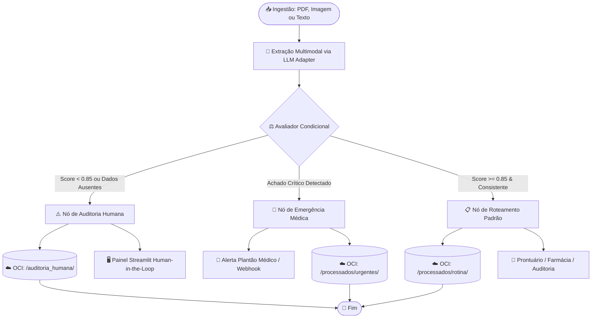

# 🏥 MediFlow — Agente Autônomo para Triagem Clínica

> Sistema inteligente e autônomo para classificação, extração multimodal estruturada e roteamento condicional de documentos clínicos com persistência em nuvem Oracle Cloud Infrastructure (OCI Always Free)[cite: 3, 5].

---

## 📌 Visão Geral do Projeto

O **MediFlow** processa fluxos documentais em saúde (receitas, laudos de exames, guias e atestados), mitigando atrasos operacionais e erros de digitação[cite: 3]. A solução combina **Clean Architecture**, **Hexagonal Architecture (Ports & Adapters)** e **Monólito Modular**, garantindo isolamento total das regras clínicas em relação a modelos de linguagem e provedores de nuvem.

---

## 🏛️ Diagrama do Fluxo de Decisão Condicional (LangGraph)

O fluxo operacional baseia-se num grafo de estados com arestas condicionais (*Conditional Edges*) para tratamento de urgências e contingência humana (*Human-in-the-Loop*):



---

## 📂 Estrutura Arquitetural do Repositório

Estrutura resumida dos arquivos existentes. A homologação humana está implementada
em `presentation/api/routers/triagem_router.py`; os mocks e fixtures ficam nos
próprios módulos de teste.

```text
mediflow/
├── .env.example
├── README.md
├── pyproject.toml                   # Metadados e configuração de testes
├── requirements.txt                 # Dependências usadas na imagem Docker
├── Dockerfile
├── docker-compose.yml               # API FastAPI e interface Streamlit
├── docker-compose.oci-local.yml     # Complemento com emulador OCI
├── docker-compose.test.yml          # API isolada com extração simulada
├── config/
│   └── settings.py                  # Configurações e seleção de ambiente
├── domain/
│   ├── entities/
│   │   ├── paciente.py
│   │   ├── documento_clinico.py
│   │   └── triagem.py
│   ├── value_objects/
│   │   ├── prioridade.py
│   │   ├── score.py                 # ScoreConfianca e limiar de confiança
│   │   └── cid.py
│   └── ports/
│       ├── llm_port.py
│       ├── storage_port.py
│       └── notifier_port.py
├── application/
│   ├── dtos/
│   │   ├── input_request.py         # Contrato de entrada e normalização de TXT
│   │   └── output_response.py       # Contrato de saída
│   ├── workflows/
│   │   ├── state.py                 # Estado da triagem
│   │   ├── nodes.py                 # Extração, urgência, rotina e auditoria
│   │   ├── graph.py                 # Construção do grafo e arestas condicionais
│   │   └── rules.py                 # Validações que exigem revisão humana
│   └── use_cases/
│       ├── processar_triagem.py     # Orquestração, notificação e persistência
│       └── acompanhar_fluxo.py      # Etapas e reconciliação do acompanhamento
├── infrastructure/
│   ├── adapters/
│   │   ├── gemini_llm_adapter.py
│   │   ├── openai_llm_adapter.py     # Alternativa disponível; sem fallback automático
│   │   ├── presentation_llm_adapter.py
│   │   ├── schemas_llm.py
│   │   ├── oci_storage_adapter.py
│   │   ├── memory_storage_adapter.py
│   │   └── webhook_notifier.py
│   ├── oci_client/
│   │   ├── client_factory.py        # Composição dos adaptadores
│   │   ├── storage_factory.py       # Memória, emulador ou OCI real
│   │   └── wait_storage.py
│   └── diagnostico.py
├── presentation_examples/           # Exemplos TXT para extração simulada
├── presentation/
│   ├── api/
│   │   ├── main.py
│   │   ├── auth.py
│   │   └── routers/
│   │       ├── triagem_router.py    # Ingestão, filas e homologação humana
│   │       ├── health_router.py
│   │       └── painel_router.py
│   └── web/
│       ├── app.py
│       ├── api_client.py
│       ├── auth.py
│       ├── components/
│       ├── app_pages/              # Páginas do painel
│       └── views/
│           ├── fila_urgencias.py
│           └── auditoria.py
└── tests/
    ├── unit/                       # Regras, fluxos e adaptadores simulados
    ├── integration/
    │   ├── test_oci_emulator.py     # SDK OCI, auditoria e homologação
    │   └── test_compose_cenarios.py # Três cenários por HTTP com emulador OCI
    ├── serve_simulated_api.py       # Entrada exclusiva da API Compose de testes
    └── demonstracao_cenarios.py     # Demonstração separada contra API ativa
```

---

## 🔀 Fluxo de contribuição

Branches (Git Flow), modelo de Pull Request, verificações de CI e regras de
proteção estão em [`docs/fluxo-de-trabalho-git.md`](docs/fluxo-de-trabalho-git.md).

---

## ⚙️ Pré-requisitos e Configuração

### 1. Clonar o Repositório e Configurar Variáveis

```bash
git clone https://github.com/HilarioGouveia/mediflow.git
cd mediflow
cp .env.example .env


```

Edite o arquivo `.env` com as configurações necessárias. Se ele já existe,
preserve suas credenciais e acrescente apenas os parâmetros que faltam.
Os arquivos de exemplo são modelos; a aplicação lê os arquivos privados:

| Arquivo | Finalidade | Quando configurar |
| --- | --- | --- |
| `.env` | Gemini, armazenamento, autenticação e alertas | Em todas as instalações |
| `.streamlit/secrets.toml` | Cliente OAuth/OIDC e segredo do cookie de login | Quando `AUTH_ENABLED=true` |

#### Parâmetros do `.env`

| Parâmetro | Uso e valor inicial |
| --- | --- |
| `APP_ENV` | Ambiente de hospedagem exibido na sidebar: `local` (padrão) ou `cloud`. Defina `cloud` na implantação; Docker e OCI não determinam esse valor. |
| `APP_MODE` | `operational` (padrão) ou `presentation`. Apresentação exige memória e desabilita webhooks externos. |
| `PRESENTATION_USE_LLM` | Em apresentação: `false` (padrão) simula os exemplos sem LLM; `true` usa Gemini real, sem fallback automático. |
| `GEMINI_API_KEY` | Chave da API Gemini para processar documentos, em qualquer modo de armazenamento. |
| `GEMINI_MODEL_NAME` | Modelo usado na análise; padrão `gemini-3.5-flash`. |
| `STORAGE_MODE` | `memory`: dados perdidos ao reiniciar; `emulator`: OCI local em Docker; `oci`: Oracle Cloud real. Padrão `memory`. |
| `OCI_SERVICE_ENDPOINT` | Endereço do emulador, usado somente em `emulator`. Para a API no Windows: `http://localhost:4599`. |
| `OCI_NAMESPACE` | Namespace do armazenamento em `emulator` e `oci`; pode ser fictício no emulador e deve ser real na nuvem. |
| `OCI_BUCKET_NAME` | Bucket em `emulator` e `oci`. Criado automaticamente no emulador; deve existir na OCI real. |
| `OCI_CONFIG_FILE` | Arquivo de credenciais Oracle, necessário somente em `oci`; padrão `~/.oci/config`. Deve estar acessível no ambiente da API. |
| `OCI_CONFIG_PROFILE` | Perfil dentro do arquivo de credenciais Oracle; padrão `DEFAULT`. |
| `AUTH_ENABLED` | `false`: acesso sem login; `true`: login na interface e token de serviço na API. Configure o mesmo valor nos dois serviços. |
| `AUTH_PROVIDER` | Nome da seção do provedor em `secrets.toml`; padrão `google`, correspondente a `[auth.google]`. |
| `AUTH_ALLOWED_EMAILS` | E-mails autorizados separados por vírgula; obrigatório com autenticação ativa. A conta também deve ter e-mail verificado pelo provedor. |
| `MEDIFLOW_API_TOKEN` | Segredo aleatório de pelo menos 32 caracteres, idêntico na interface e na API; obrigatório com autenticação ativa. Não é o token Google do usuário. |
| `WEBHOOK_URL` | Opcional. Vazio registra alertas apenas em log; preenchido envia ao webhook configurado. |

Para começar sem login e sem OCI, preencha a chave Gemini e mantenha:

```ini
GEMINI_API_KEY="sua_chave_gemini"
GEMINI_MODEL_NAME="gemini-3.5-flash"
STORAGE_MODE="memory"
AUTH_ENABLED="false"
```

O login independe do armazenamento: pode ser ativado em `memory`, `emulator`
ou `oci`. Parar o emulador não muda o modo automaticamente; uma API configurada
como `emulator` continua precisando dele para armazenar e consultar documentos.

A sidebar mostra ambiente, autenticação e armazenamento separadamente. Em
**Armazenamento e integrações**, a execução da interface indica Docker quando
o marcador `/.dockerenv` está presente, ou Python direto quando ausente. Essa
identificação se refere ao servidor Streamlit; a API pode executar separadamente.

#### Parâmetros do `.streamlit/secrets.toml`

Para habilitar o login, copie o modelo somente se o arquivo privado ainda não existe:

```powershell
Copy-Item .streamlit/secrets.example.toml .streamlit/secrets.toml
```

| Seção e parâmetro | Finalidade |
| --- | --- |
| `[auth]` → `redirect_uri` | Endereço de retorno do login. Localmente: `http://localhost:8501/oauth2callback`; deve coincidir com o cadastrado no provedor. |
| `[auth]` → `cookie_secret` | Segredo aleatório para o cookie de sessão; gere um valor diferente de `MEDIFLOW_API_TOKEN`. |
| `[auth.google]` → `client_id` | Identificador do cliente OAuth cadastrado para a aplicação no Google. |
| `[auth.google]` → `client_secret` | Segredo do mesmo cliente OAuth. A chave Gemini não substitui esse valor. |
| `[auth.google]` → `server_metadata_url` | Metadados OIDC do provedor; o modelo já contém o endereço do Google. |

Configure o cliente OAuth e os secrets antes de definir `AUTH_ENABLED=true`,
preencher os e-mails autorizados e definir o token de serviço no `.env`.
O passo a passo está em [Autenticação OIDC](docs/autenticacao.md).
Mantenha `.env` e `.streamlit/secrets.toml` fora do Git.

#### Configuração ao executar com Docker

O Compose pode definir valores que têm prioridade sobre o `.env`:

- `docker-compose.oci-local.yml` configura a API com `STORAGE_MODE=emulator`
  e `OCI_SERVICE_ENDPOINT=http://oci-emulator:4599`. O volume do Docker preserva
  os dados entre reinícios. Veja [OCI local em container](#oci-local-em-container).
- `docker-compose.auth.yml` força `AUTH_ENABLED=true` na interface e na API,
  exige os e-mails e o token de serviço e monta `secrets.toml` na interface.
  Pode ser usado com ou sem o complemento do emulador.

Após alterar configurações, reinicie os processos Python. No Docker, execute
novamente `docker compose` com os mesmos arquivos `-f` e `up -d` para aplicar
o ambiente atualizado aos containers; apenas `restart` não atualiza as variáveis.
Use `--build` quando precisar reconstruir a imagem, como após mudar dependências.

### 2. Execução Rápida via Docker Compose

Para iniciar a API FastAPI (porta 8000) e a UI Streamlit (porta 8501) simultaneamente:

```bash
docker-compose up --build -d

```

---

## 🧪 Demonstração dos 3 Cenários Obrigatórios

Execute o script automatizado para verificar a conformidade dos três cenários avaliados:

```bash
python tests/demonstracao_cenarios.py

```

| Cenário | Entrada | Decisão do Grafo | Destino OCI Always Free |
| --- | --- | --- | --- |
| **1. Rotina**<br> | Receita médica ambulatorial legível.

 | Aprovado automaticamente sem contingência humana.

 | `processados/rotina/`<br> |
| **2. Urgência**<br> | Laudo de imagem com TEP agudo detectado.

 | `Fila_Emergencia_Medica` + Disparo imediato de alerta.

 | `processados/urgentes/`<br> |
| **3. Ambiguidade**<br> | Documento rasurado ou CRM ausente (score < 0.85).

 | `requer_auditoria_humana: true` $\rightarrow$ Fila Streamlit.

 | `auditoria_humana/`<br> |

---

## ☁️ Oracle Cloud Infrastructure (OCI Always Free)

A persistência do MediFlow está alinhada às restrições de custo zero do programa ONE:

* **OCI Object Storage**: Organização lógica de buckets por status (`/recebidos`, `/processados`, `/auditoria_humana`).

* **OCI Compute Instance (Opcional)**: Execução conteinerizada via VM Ampere A1 (ARM) ou AMD Micro da camada Always Free.


## Estado de validacao (17/10/2026)

A homologacao de emergencia
persiste o registro antes de chamar o notificador; a resposta inclui `notificacao_enviada`.
Uma falha de notificacao nao desfaz a homologacao.

```powershell
python -m venv .venv
.\.venv\Scripts\Activate.ps1
python -m pip install -r requirements.txt
Copy-Item .env.example .env
python -m pytest tests/unit
python -m uvicorn presentation.api.main:app --host 127.0.0.1 --port 8000
```

Em outro terminal, com o ambiente virtual ativado:

```powershell
python -m streamlit run presentation/web/app.py
```

Edite `.env` com suas configuracoes. `WEBHOOK_URL` e opcional; sem URL, o notificador
registra o alerta apenas em log. O retorno positivo do notificador nesse modo nao
comprova entrega a uma equipe externa.

O armazenamento agora e escolhido explicitamente por `STORAGE_MODE`: `memory`,
`emulator` ou `oci`. O padrao `memory` perde os dados ao reiniciar e pode retornar
`status_backup="sucesso"` para operacoes simuladas. Esse modo nao comprova
persistencia em nuvem. Com `oci` ou `emulator`, erros nao ativam memoria
silenciosamente. Para OCI real no Docker, as credenciais OCI e a
chave privada precisam ser disponibilizadas por montagem de volume, com caminhos
validos dentro do container; o Compose atual nao configura essa montagem.

A conexao real com Gemini terminou em `ConnectError` nas verificacoes. OCI real e
webhook externo permanecem sem validacao. Os tres cenarios em
`tests/demonstracao_cenarios.py` exigem a API ativa na porta 8000 e configuracao de IA;
execute-os separadamente dos testes unitarios.

### Painel operacional

**Armazenamento e integrações** lista objetos reais via
`GET /triagem/armazenamento/objetos`, com contagens para `recebidos/`,
`processados/`, `auditoria_humana/` e `fluxo/`. A tabela permite filtrar área e
caminho; não lê o conteúdo dos objetos. As contagens representam objetos, não
documentos únicos. Falhas são estados do processamento e não uma pasta fictícia.
Nome, extensão e caminho vêm das chaves listadas; data, tamanho e integridade
não são verificados. Falha na consulta aparece como indisponibilidade, não como zero.

Em **Nova triagem**, escolha **Enviar arquivo** (PDF, JPG, PNG ou TXT) ou
**Fotografar documento**. A câmera captura uma página por vez, pede permissão
ao navegador e depende de câmera disponível e contexto seguro (localhost ou HTTPS).
Capture uma imagem legível e clique em **Executar triagem** para iniciar a análise.
Se a câmera não estiver disponível, use o upload. Não há integração com scanner
físico nem correção automática de perspectiva. Texto e JSON seguem disponíveis na
API; não aparecem como entradas separadas na interface do atendente.
Na apresentação simulada, a câmera fica desabilitada: use os exemplos TXT.

#### Modo Apresentação

Configure no `.env` e reinicie a API:

```dotenv
APP_MODE="presentation"
PRESENTATION_USE_LLM="false"
STORAGE_MODE="memory"
```

O aviso amarelo permanente identifica a apresentação. Em **Nova triagem**, baixe
um dos três exemplos TXT (rotina, urgência e revisão humana) e faça seu upload.
A extração simulada reconhece o conteúdo desses arquivos, inclusive após renomear,
e retorna dados predefinidos. As regras de roteamento, filas, original, histórico
e homologação continuam usando o backend normal. Arquivos desconhecidos não recebem
resultados inventados: a análise fica não concluída, com orientação e revisão humana.

Não há chamada à LLM no modo simulado. Os documentos e resultados ficam somente
na memória da API e são compartilhados pelos usuários dessa instância; reiniciar
a API descarta esses registros. Alertas externos ficam desabilitados mesmo com
`WEBHOOK_URL` preenchido; mensagens ainda podem aparecer nos logs. Use somente
documentos fictícios. A apresentação não valida a integração com Gemini.

Para demonstrar Gemini de verdade, use `PRESENTATION_USE_LLM="true"` e reinicie
a API. O aviso identifica a análise real, que depende de chave, rede e cota, envia
conteúdo ao provedor e não muda silenciosamente para simulação em caso de falha.
O armazenamento continua temporário e os webhooks continuam desabilitados.

Para voltar à operação normal, use `APP_MODE="operational"` e reinicie a API.
Apresentação com `STORAGE_MODE` diferente de `memory` é rejeitada na inicialização.
No Docker, use o Compose base; o complemento `docker-compose.oci-local.yml` força
`emulator` e é incompatível com este modo. Aplique mudanças com `up -d`, usando
`--build` na primeira execução após adicionar esse código. A UI consulta o modo
efetivo da API; não há seletor que altere o modo compartilhado durante a sessão.

O resultado de **Nova triagem** e o detalhe em **Documentos clínicos** incluem
um resumo com categoria, especialidade, confiança da classificação e origem
quando registrada. Campos de identificação não preenchidos são apresentados
para conferência, sem presumir ilegibilidade ou obrigatoriedade. Registros antigos
sem canal de origem exibem “Não registrada”. Falhas de extração não exibem a
classificação de contingência como avaliação clínica concluída.

Nos detalhes de **Documentos clínicos**, a linha do tempo consulta os eventos
persistidos da mesma execução do documento. Registros antigos sem eventos,
horários ausentes e estados reconciliados são identificados explicitamente.
O registro de destino não comprova entrega externa. Uma falha na consulta do
histórico não bloqueia a leitura do resultado da triagem.

A **Revisão humana** apresenta o original e os campos editáveis lado a lado.
Ao escolher aprovação ou rejeição, mostra as alterações propostas, o parecer e
o destino quando aplicável. A decisão só é enviada após **Confirmar e salvar
decisão**. Cancelar mantém a edição; trocar de pendência ou atualizar os dados
do documento invalida a confirmação preparada. Alterações adicionais no formulário
precisam ser submetidas novamente para atualizar o resumo antes de confirmar.

#### Diagnóstico de configuração e feedback

Ao abrir uma sessão, a interface consulta `GET /triagem/diagnostico` e mostra
problemas previsíveis com orientações de correção. O diagnóstico identifica chave
Gemini ausente ou de exemplo, configuração OCI inválida, armazenamento temporário,
autenticação da API e alertas somente em log. A configuração OIDC incompleta é
tratada pela tela de login antes do acesso ao painel. Valores inválidos rejeitados
na inicialização da API devem ser corrigidos no terminal para que ela possa iniciar.

Em **Armazenamento e integrações**, **Verificar conexões** atualiza o diagnóstico
e consulta o bucket usando o SDK OCI, com timeout e sem repetição automática.
Essa consulta não grava documentos nem cria buckets; se o emulador estiver vazio,
o bucket poderá precisar ser inicializado pela execução normal do app.
Não há inferência Gemini nem envio de webhook nessa verificação. Uma chave
preenchida não comprova validade ou cota; leitura do bucket não comprova escrita.

O diagnóstico informa o instante da consulta, não é monitoramento contínuo.
**Atualizar dados** refaz a inspeção de configuração. Erros conhecidos de Gemini
ou armazenamento desabilitam novas triagens, preservando as páginas de consulta.
Após mudar `.env`, reinicie a API (ou recrie os containers com `up -d`) e atualize
o diagnóstico. Uma API sem o novo endpoint precisa ser reiniciada para carregá-lo.

Login nativo OIDC, autorização por e-mail e proteção da API estão preparados em
[docs/autenticacao.md](docs/autenticacao.md). O acesso local permanece sem login
até configurar o cliente OAuth real, os secrets e ativar `AUTH_ENABLED` nos dois serviços.

O painel abre na Central de triagem, com indicadores calculados dos documentos
armazenados, busca e encaminhamento para revisao. Nao ha chave de demonstracao ou
metricas ficticias. A navegacao lateral agrupa Central, Nova triagem, Documentos
clinicos, Urgencias e Revisao humana em Triagem, e Armazenamento e integracoes em
Plataforma. O tema usa verde-petroleo na sidebar, que pode ser recolhida pelo controle
nativo do Streamlit. A triagem aceita PDF, JPG/PNG, TXT, JSON ou texto colado e preserva o
ultimo resultado na sessao. A auditoria permite conferir o original ao lado dos
campos editaveis. O historico consulta documentos armazenados, com busca por ID ou
paciente e exportacao JSON; nao representa um log imutavel de eventos.

As paginas compartilham cabecalho, cartoes, indicadores e estados vazios. Nova triagem
mostra recebimento em largura completa e quatro etapas documentais, sem simular
progresso do servico. Documentos clinicos permite combinar filtros por tipo, estado,
prioridade, destino e revisao. Urgencias oferece busca e filtro de revisao; a auditoria
mantem original e formulario lado a lado. Armazenamento e integracoes apresenta o
ambiente configurado e a organizacao logica dos objetos, sem afirmar conexao ou
entrega externa apenas pela configuracao.

### Filas de processamento

A pagina Filas de processamento apresenta Recebidos, Em analise, Revisao humana,
Processados e Encaminhados. O quadro consulta `GET /triagem/filas/processamento`
a cada cinco segundos e oferece busca e filtros por categoria, prioridade e destino.
A movimentacao e automatica; abrir uma pendencia seleciona o documento na revisao.
Falhas e rejeitados aparecem separadamente, sem serem tratados como encaminhados.

O acompanhamento e salvo no mesmo adaptador de armazenamento, em `fluxo/<hash-do-id>.json`,
com identificador da execucao, ultima etapa e eventos com horario UTC. Documentos
anteriores usam seu resultado armazenado, sem horarios retroativos. O historico de
etapas corresponde a execucao atual, nao a um log imutavel de todas as reexecucoes.
Use identificadores unicos por documento. Uma nova execucao com o mesmo ID substitui
seu acompanhamento; resultados de execucoes anteriores nao encerram a nova tentativa.

Processados e uma etapa transitoria entre a triagem concluida e o registro do destino;
pode aparecer apenas no historico do cartao. Encaminhado indica destino registrado,
sem confirmar recebimento pelo setor, entrega de alerta ou atendimento. Nao e uma
fila de tarefas em segundo plano: a ingestao continua sincrona, executada fora do
event loop da API para permitir consultas concorrentes. O quadro mostra a ultima
etapa persistida; uma interrupcao abrupta do processo pode deixar essa etapa sem
conclusao ate a proxima execucao. No modo memoria, os registros continuam efemeros.

Os indicadores fixos foram removidos. Falhas de consulta aparecem como erro, e o
modo em memoria e identificado. A tela Integracoes informa o modo dos adaptadores;
ela nao executa inferencia, teste de conexao OCI ou envio de alertas. O painel de
urgencias nao informa entrega de notificacao sem comprovacao.

A API inclui `GET /triagem/historico`, `GET /triagem/integracoes` e
`GET /triagem/original?caminho=recebidos/...`. Reinicie a API para carregar as rotas
novas. Instale as dependencias atualizadas com `python -m pip install -r requirements.txt`
para habilitar o visualizador PDF nativo. Sem o complemento PDF, o original continua
disponivel para download. O tema visual fica em `.streamlit/config.toml`.

Os testes em `tests/unit/test_painel.py` cobrem as consultas do painel, recuperacao
do original, paginacao OCI, falhas de consulta e preservacao do resultado ao navegar.

O retorno de `salvar_arquivo` e verificado: se o original nao for salvo,
`status_backup="falha"`, mesmo que o relatorio JSON seja salvo depois.

Nao versione `.env`, ambientes virtuais, credenciais OCI ou chaves privadas.

## OCI local em container

O complemento Compose usa [Floci OCI](https://github.com/floci-io/floci-oci),
emulador de terceiros, na versao fixada `0.5.0`. Usa o SDK `oci` nativo e o mesmo
`OCIStorageAdapter` da nuvem. A fabrica de infraestrutura escolhe o ambiente;
dominio, grafo e casos de uso dependem somente de `StoragePort`. O adaptador de
memoria e separado. O emulador nao valida IAM real, assinaturas ou custos Always Free.

Para subir API, interface e emulador:

```powershell
docker compose -f docker-compose.yml -f docker-compose.oci-local.yml up --build -d
```

Interface: http://localhost:8501. API: http://localhost:8000/docs.
O emulador atende apenas na interface local, porta 4599. O bucket configurado em
`OCI_BUCKET_NAME` e criado automaticamente no ambiente emulado. O namespace e
descoberto pelo SDK. Uma chave RSA ficticia e gerada em memoria para assinar as
requisicoes locais; nenhuma credencial Oracle real e usada. O volume nomeado
`mediflow-oci-data` preserva os documentos; nao use `down -v` se quiser mante-los.
Nao e necessario montar o socket Docker no emulador de Object Storage.
O complemento monta os diretorios de codigo em modo somente leitura, facilitando
o desenvolvimento local. Alteracoes no backend exigem reiniciar a API; mudancas
nas dependencias exigem reconstruir a imagem.

Para usar a API executada no Windows com somente o emulador em Docker:

```powershell
docker compose -f docker-compose.yml -f docker-compose.oci-local.yml up -d oci-emulator
```

Configure no `.env`: `STORAGE_MODE="emulator"` e
`OCI_SERVICE_ENDPOINT="http://localhost:4599"`, e reinicie a API. O complemento
Compose define esses valores para os containers automaticamente, sem alterar `.env`.

Teste de integracao real com o SDK OCI, sem chamadas Gemini:

```powershell
$env:RUN_OCI_EMULATOR_TESTS="1"
.\.venv\Scripts\python.exe -m pytest tests/integration/test_oci_emulator.py
```

O teste cria documentos sinteticos em um bucket de teste, consulta o original e o
historico pela API e homologa a auditoria, verificando gravacao, listagem, leitura,
movimentacao e remocao. Remove apenas os objetos que ele proprio criou.

Para conferir persistencia apos reinicio do container:

```powershell
.\.venv\Scripts\python.exe scripts/validar_oci_local.py gravar
docker compose -f docker-compose.yml -f docker-compose.oci-local.yml restart oci-emulator
.\.venv\Scripts\python.exe scripts/validar_oci_local.py conferir
```

Para a nuvem real, use `STORAGE_MODE="oci"`, configure namespace, bucket e
credenciais Oracle e execute sem o complemento `docker-compose.oci-local.yml`.
O bucket deve existir: a criacao automatica esta restrita ao modo emulado.

## Modelo e validacao Gemini

O modelo e configuravel por `GEMINI_MODEL_NAME` no `.env` (padrao:
`gemini-3.5-flash`). Reinicie a API apos alterar o arquivo, pois o servico e
mantido em cache. A tela Integracoes mostra o modelo configurado.

`GEMINI_TIMEOUT_MS` define o timeout de cada chamada (padrao: 20000 ms).
`GEMINI_MAX_ATTEMPTS` limita o total de tentativas (padrao: 3; maximo: 3).
Falhas temporarias de rede, HTTP 408, 429 e 500/502/503/504 recebem tentativas
com espera exponencial e jitter. Erros 400/401/403/404 e respostas invalidas nao
sao repetidos. O SDK tem sua repeticao interna desativada para evitar multiplicacao
de chamadas. A resposta e revalidada com Pydantic antes do roteamento.

Se a extracao falhar, o retorno JSON inclui `status="erro"` e `erro_extracao`
com codigo e mensagem segura. O documento e encaminhado para auditoria humana;
isso nao representa uma classificacao clinica concluida. Campos clinicos vazios e
score zero sao apenas valores de compatibilidade do contrato, nao uma avaliacao
de prioridade. A aprovacao humana resolve o erro atual e conserva o erro anterior
no registro persistido.

Validacao real com dados sinteticos (faz chamadas a API Gemini e pode consumir cota):

```powershell
.\.venv\Scripts\python.exe scripts/validar_gemini.py
.\.venv\Scripts\python.exe scripts/validar_gemini.py --multimodal
```

O primeiro comando verifica rotina, urgencia e ambiguidade. O segundo inclui PDF
digitalizado e PNG sinteticos legiveis. Esses testes nao comprovam precisao clinica
geral, leitura de manuscritos, persistencia OCI real nem entrega de notificacoes.
Falhas de infraestrutura interrompem o teste com codigo de saida diferente de zero.


### Regressões de triagem e integração determinística

Achados críticos geram alerta ao plantão mesmo com pendências de CRM, paciente,
confiança ou consistência. Quando há pendência, o documento permanece como registro
único em `auditoria_humana/`, com destino clínico de emergência e revisão obrigatória.
A consulta `/triagem/filas/urgencias` também inclui esses registros; a consulta de
auditoria mantém a pendência até a homologação. A presença de notificação no relatório
registra sua geração, sem comprovar entrega externa. As regras clínicas existentes
não foram ampliadas e precisam de validação clínica antes do uso real.

Uploads TXT aceitam UTF-8 com ou sem BOM. Base64 é validado estritamente e o texto
é decodificado antes da extração; o original permanece byte a byte no armazenamento.
Formatos não reconhecidos retornam 415; TXT com codificação inválida, vazio de texto
ou caracteres binários de controle retorna 422 (arquivo sem bytes retorna 400).
Texto direto no JSON é enviado literalmente, mesmo quando se parece com Base64.

Os testes locais de regressão não exigem Gemini:

```powershell
.\.venv\Scripts\python.exe -m pytest tests/unit/test_regressoes_triagem.py tests/unit/test_gemini_resilience.py
```

Para validar os três cenários por HTTP contra uma API Compose separada na porta
8001, usando SDK OCI e emulador:

```powershell
docker compose -f docker-compose.yml -f docker-compose.oci-local.yml -f docker-compose.test.yml up --build -d oci-emulator mediflow-test-api
$env:RUN_COMPOSE_TESTS="1"
$env:OCI_SERVICE_ENDPOINT="http://localhost:4599"
.\.venv\Scripts\python.exe -m pytest tests/integration/test_compose_cenarios.py -q
```

Essa API utiliza exclusivamente os exemplos TXT conhecidos de
`presentation_examples/`, com extração predefinida. Não chama Gemini
nem webhooks; não deve ser usada para documentos reais. Os testes conferem o upload,
o original e relatório pelo SDK OCI, a decisão, as filas e o acompanhamento,
removendo apenas os objetos criados por cada execução. Para encerrá-la sem remover
os dados existentes do emulador:

```powershell
docker compose -f docker-compose.yml -f docker-compose.oci-local.yml -f docker-compose.test.yml stop mediflow-test-api
```

`tests/demonstracao_cenarios.py` permanece como verificação separada da API
configurada pelo operador, inclusive com Gemini real. Seus resultados não substituem
os testes determinísticos nem comprovam acesso à OCI real quando executados em memória.
