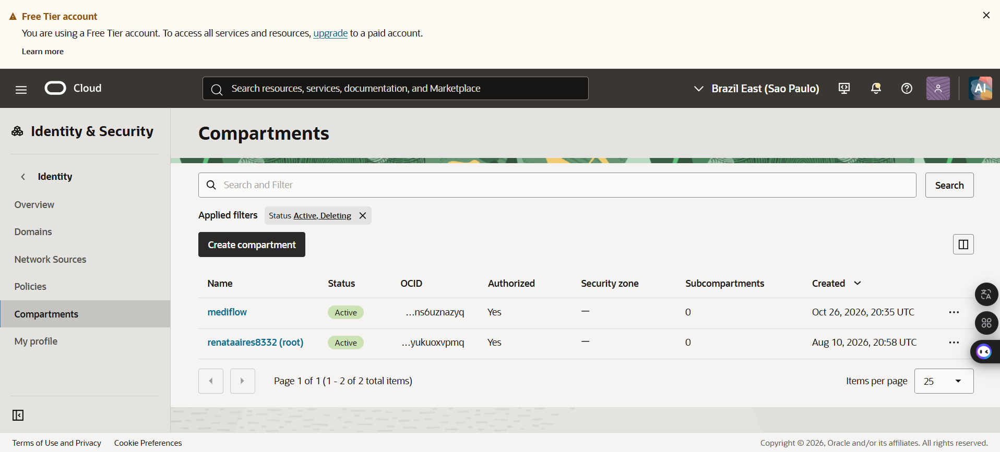
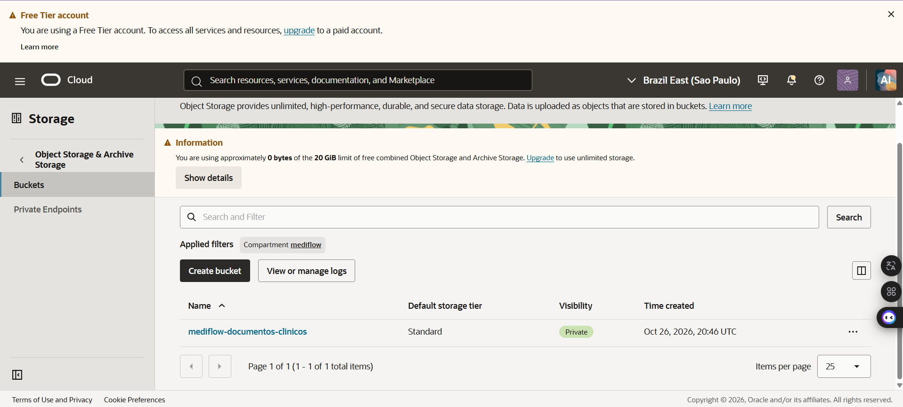
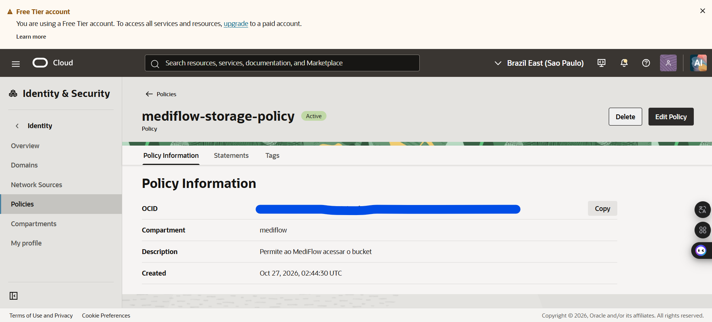

# Reprodução OCI - Conta Alternativa

### Responsável: Renata Rocha

### Data: 27/10/2026

---

## Objetivo

Validar a reprodução da infraestrutura OCI em uma conta Oracle Always Free alternativa, conforme orientação do guia docs/preparar-oci.md.

---

## Recursos criados

 ### Compartimento

- mediflow

### Bucket

- mediflow-documentos-clinicos

### IAM

Grupo

- mediflow-storage

Usuário técnico:

- mediflow-app

Política:

- mediflow-storage-policy

---

### Configuração local

- Arquivo OCI config criado

- Chave privada criada e armazenada localmente

- Chave pública criada

- Variáveis OCI configuradas no arquivo .env

- Namespace da tenancy configurado

---

### Resultado

A infraestrutura OCI foi reproduzida com sucesso em uma conta Oracle Always Free independente.

Foram concluídas as etapas de:

- Compartimento

- Bucket privado

- IAM

- Política de acesso

- Chaves de API

- Configuração local

---

### Observação

A validação operacional completa depende da execução integrada do MediFlow e das demais dependências do ambiente compartilhado da equipe.

## Evidências Visuais

Compartimento Mediflow

---

Bucket mediflow-documentos-clínicos

---

Política IAM

---

Grupo IAM mediflow-storage e usuário técnico mediflow-app

