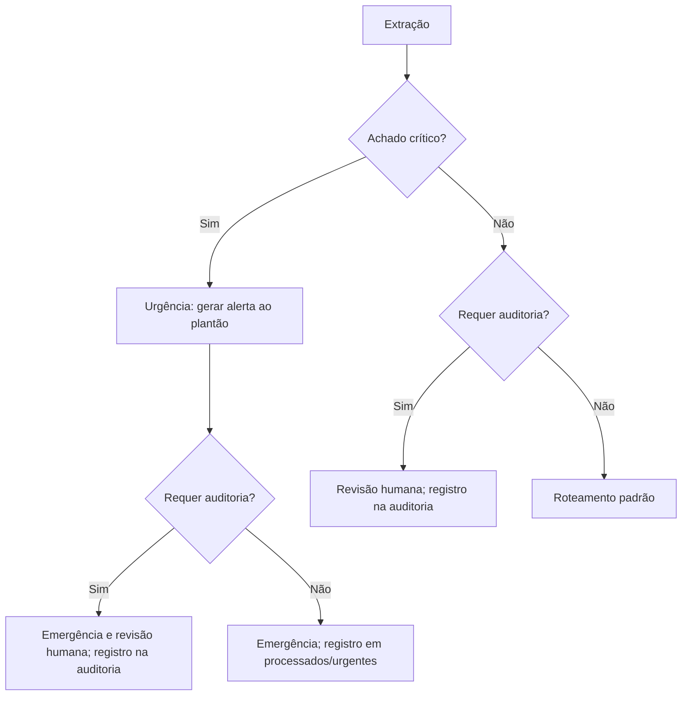

# Documento de Design de Software (SDD) — MediFlow

**Projeto:** MediFlow — Agente Autônomo para Triagem, Extração e Roteamento de Documentos Clínicos

**Versão do documento:** 1.1

**Atualização:** 19/10/2026

**Status:** MVP implementado com verificações locais; validação clínica pendente.

**Ecossistema:** Python 3.11, Oracle Cloud Infrastructure (OCI Always Free), LangGraph, FastAPI, Streamlit

---

## 1. Visão Geral e Objetivos do Sistema

### 1.1 Contexto e Justificativa de Negócio

Ambientes hospitalares, clínicas e operadoras de saúde processam volumes massivos de laudos, prescrições, atestados e guias TISS/TUSS diariamente. O trabalho manual de digitação e triagem gera atrasos no fluxo de pronto-atendimento e custos com glosas hospitalares. O **MediFlow** provê um pipeline autônomo com inteligência multimodal para classificar documentos clínicos, extrair dados essenciais estruturados, aplicar regras de contingência (*Human-in-the-Loop*) e persistir o ciclo de vida documental em armazenamento configurável (memória, emulador OCI ou OCI real).

### 1.2 Requisitos Mandatórios (MVP)

* **Ingestão Multimodal:** Requisições JSON em `/triagem` e uploads PDF, imagens (JPG/PNG) ou TXT UTF-8 em `/triagem/upload`. O enum de entrada inclui `JSON`, mas o upload não possui um parser específico para arquivos JSON.

* **Classificação e Extração Estruturada:** Identificação da categoria documental e extração tipada de dados do paciente, médico solicitante (CRM), hipótese diagnóstica, CID-10 e medicamentos utilizando LLMs.

* **Grafo de Decisão Condicional:** Orquestração de regras clínicas com nós e arestas condicionais (*Conditional Edges*) para detecção de urgências e revisão humana independentes: um caso pode exigir ambas.

* **Persistência:** Memória, emulador OCI ou OCI real, conforme `STORAGE_MODE`. Originais em `recebidos/`, resultados em `processados/` ou `auditoria_humana/` e acompanhamento em `fluxo/`.

* **Interfaces do Sistema:** API REST via FastAPI para automações e painel web via Streamlit para gestão e auditoria.

---

## 2. Arquitetura do Sistema

O sistema combina **Arquitetura Hexagonal (Ports & Adapters)**, **Clean Architecture** e **Monólito Modular**. A implementação atual está organizada por camadas (`domain`, `application`, `infrastructure`, `presentation`), com portas para IA, armazenamento e notificações. A organização por módulos de negócio discutida como evolução ainda não foi implementada. As decisões efetivamente aplicadas ao fluxo estão em `application/workflows/graph.py`, `nodes.py` e `rules.py`.

```
┌────────────────────────────────────────────────────────────────────────┐
│                        PRESENTATION LAYER                              │
│   FastAPI Endpoints (/triagem, /health)  │  Streamlit UI & Dashboards  │
└───────────────────────────────────┬────────────────────────────────────┘
                                    │ Chama DTOs / Casos de Uso
┌───────────────────────────────────▼────────────────────────────────────┐
│                        APPLICATION LAYER                               │
│  • Schemas Pydantic (Input/Output DTOs)                                │
│  • Workflows & Grafo Condicional LangGraph (State, Nodes, Edges)       │
│  • Casos de Uso: ProcessarTriagemUseCase                               │
└───────────────────┬────────────────────────────────┬───────────────────┘
                    │                                │
    Implementa Portas│                                │ Depende do Domínio Puro
                    │                                │
┌───────────────────▼──────────────┐   ┌─────────────▼───────────────────┐
│       INFRASTRUCTURE LAYER       │   │          DOMAIN LAYER           │
│  • GeminiLLMAdapter              │   │  • Entidades: TriagemClinica,   │
│  • OpenAILLMAdapter (Alternativa)   │   │    Paciente, DocumentoClinico   │
│  • OCIStorageAdapter             │   │  • Value Objects: CID10,        │
│  • WebhookNotifierAdapter        │   │    NivelPrioridade, Score       │
│  • OCI Client Factory            │   │  • Interfaces (Ports): LLMPort, │
│                                  │   │    StoragePort, NotifierPort    │
└──────────────────────────────────┘   └─────────────────────────────────┘

```

### 2.1 Camadas do Sistema

1. **Domain (Núcleo Puro):** Isento de dependências de bibliotecas de terceiros. Contém a lógica das entidades clínicas, cálculo de hash criptográfico de integridade e objetos de valor com validações matemáticas e clínicas.

2. **Application (Orquestração):** Define os contratos de entrada e saída via Pydantic (`TriagemRequestDTO`, `TriagemResponseDTO`), a máquina de estados do LangGraph e o caso de uso `ProcessarTriagemUseCase`.

3. **Infrastructure (Adaptadores Técnicos):** Implementações concretas das portas abstratas. Integra o SDK `google-genai` para extração multimodal com *Structured Outputs*, SDK `oci` para persistência em Object Storage e webhooks de notificação.

4. **Presentation (Apresentação):** Routers modulares FastAPI para comunicação HTTP REST e interface web Streamlit para visualização assistida por humanos.

---

## 3. Modelo de Dados e Contratos de Interface

### 3.1 DTO de Entrada (`TriagemRequestDTO`)

Valida os formatos permitidos e a origem antes de disparar o fluxo:

```python
class TipoArquivoEnum(str, Enum):
    PDF = "PDF"
    IMAGEM = "IMAGEM"
    JSON = "JSON"
    TEXTO = "TEXTO"

class TriagemRequestDTO(BaseModel):
    documento_id: str
    tipo_arquivo: TipoArquivoEnum
    documento_texto: Optional[str] = None
    arquivo_base64: Optional[str] = None
    canal_origem: str

```

### 3.1.1 Normalização e validação de TXT

`TriagemRequestDTO.conteudo_para_extracao()` decodifica `arquivo_base64` com
validação estrita quando `tipo_arquivo=TEXTO`. Os bytes devem ser UTF-8, com BOM
opcional. Acentos e quebras de linha são preservados; o original é armazenado sem
alteração. Texto em `documento_texto` permanece literal, mesmo se parecer Base64.

O upload aceita PDF, PNG, JPG e TXT identificado por extensão ou MIME. Formato não
reconhecido retorna 415; arquivo sem bytes retorna 400; TXT sem texto útil, com
codificação inválida ou caracteres binários de controle retorna 422. Base64 inválido
para TEXTO enviado via JSON também retorna 422, sem chamar a extração. Essa validação
não equivale à inspeção completa de assinatura e conteúdo de todos os formatos.

### 3.2 DTO de Saída Padronizado (`TriagemResponseDTO`)

O campo `canal_origem` preserva o valor informado no recebimento, tanto na
resposta quanto no relatório persistido. É opcional, com padrão `null`, para
permitir a leitura de registros antigos sem origem registrada.

Exemplo de resposta de urgência sem pendências (contrato em `application/dtos/output_response.py`):

```json
{
  "status": "processado",
  "documento_id": "DOC-CLIN-2026-8942",
  "canal_origem": "Pronto_Socorro",
  "execucao_id": "execucao-sintetica",
  "acompanhamento_fluxo_confirmado": true,
  "erro_extracao": null,
  "classificacao": {
    "tipo_documento": "Laudo de Exame de Imagem",
    "especialidade": "Radiologia / Pneumologia",
    "nivel_prioridade": "Urgente",
    "score_confianca_classificacao": 0.99
  },
  "dados_extraidos": {
    "paciente": { "nome": "Carlos Eduardo Mendes", "idade": 52 },
    "medico_solicitante": { "nome": "Dra. Renata Silveira", "crm": "145892-SP" },
    "exame_realizado": "Tomografia de Torax com contraste",
    "diagnostico_principal": "Tromboembolismo Pulmonar Agudo (TEP)",
    "cid_sugerido": "I26.9",
    "medicamentos": []
  },
  "decisao_roteamento": {
    "destino_principal": "Fila_Emergencia_Medica",
    "requer_auditoria_humana": false,
    "justificativa_roteamento": "Achado critico de alta gravidade (TEP agudo) detectado em paciente sintomatico.",
    "notificacao_gerada": {
      "canal": "Alerta_Plantao_Medico",
      "mensagem": "ALERTA URGENTE: Laudo critico de TEP Agudo para paciente Carlos Eduardo Mendes no Pronto-Socorro."
    }
  },
  "armazenamento_oci": {
    "bucket": "mediflow-documentos-clinicos",
    "caminho_objeto": "processados/urgentes/DOC-CLIN-2026-8942.json",
    "caminho_documento_bruto": "recebidos/DOC-CLIN-2026-8942.txt",
    "status_backup": "sucesso"
  }
}

```

---

## 4. Design do Grafo Condicional (LangGraph)



O diagrama representa as decisões internas. No grafo compilado, os nós
`processar_urgencia`, `processar_auditoria` e `processar_padrao` são terminais;
a avaliação de pendências de um caso crítico ocorre dentro do nó de urgência.

### 4.1 Nós e regras de transição

- `extrair_informacoes` invoca `LLMPort` com texto normalizado ou conteúdo multimodal.
  Falhas classificadas de extração produzem `erro_extracao`, score zero e retenção
  para revisão, sem alerta clínico inventado.
- `avaliar_caminho_decisao` verifica primeiro `achado_critico`; caso verdadeiro,
  seleciona urgência. Nos demais casos, usa `requer_auditoria` antes da rota padrão.
- `rules.py` exige revisão quando há falha de extração, score abaixo de 0.85,
  paciente sem nome, CRM fora do formato aceito, receituário sem medicamentos ou
  laudo sem exame e sem diagnóstico. A validação de CRM é sintática e não consulta
  o registro profissional nem comprova sua autenticidade.
- `processar_urgencia` gera alerta para `Alerta_Plantao_Medico` e define destino
  `Fila_Emergencia_Medica`. Se houver pendência, mantém `requer_auditoria_humana=true`
  e grava em `auditoria_humana/{id}.json`; caso contrário, usa
  `processados/urgentes/{id}.json`.
- `processar_auditoria` define `Fila_Revisao_Humana` para casos não críticos com
  pendências. A justificativa registra os motivos disponíveis.
- `processar_padrao` direciona receituários à farmácia, guias/autorizações à auditoria
  de autorizações e outros documentos ao prontuário. O caminho usa
  `processados/{prioridade.lower()}/{id}.json`; a prioridade textual é fornecida
  pela extração. Os mapeamentos adicionais dos objetos de valor não são aplicados
  automaticamente pelo nó.

### 4.2 Urgência e revisão simultâneas

Existe um único relatório na auditoria, consultável em `/triagem/filas/auditoria`
e também em `/triagem/filas/urgencias` quando seu destino é emergência. O
acompanhamento permanece em `revisao_humana`. A homologação é implementada em
`presentation/api/routers/triagem_router.py`, pelo endpoint `/triagem/homologar`.

O caso de uso tenta enviar a notificação após o grafo e antes de persistir o
relatório final. `notificacao_gerada` registra o payload; não comprova entrega
externa. Falhas de envio são registradas em log. As regras clínicas existentes
precisam de validação clínica antes do uso real.

---

## 5. Armazenamento e execução local

`STORAGE_MODE` seleciona `memory`, `emulator` ou `oci`, por meio de
`infrastructure/oci_client/storage_factory.py`. Falhas em OCI ou emulador não
acionam armazenamento em memória automaticamente.

- `recebidos/`: originais em PDF, imagem ou TXT.
- `processados/urgentes/`: resultados críticos sem pendências de revisão.
- `processados/{prioridade}/`: resultados da rota padrão.
- `auditoria_humana/`: resultados que exigem revisão, inclusive urgentes.
- `fluxo/`: registros e eventos de acompanhamento por documento.

O Compose principal executa API e interface. `docker-compose.oci-local.yml`
acrescenta o emulador de terceiros Floci OCI e configura o armazenamento emulado.
`docker-compose.test.yml` acrescenta a API isolada de testes na porta 8001, com
extração simulada e sem webhooks externos. O emulador usa o SDK OCI, mas não valida
credenciais e IAM da nuvem real. Instruções operacionais estão no README.

Gemini é o provedor operacional configurado pela fábrica. O adaptador OpenAI
existe como alternativa, sem fallback automático. LangGraph é usado diretamente;
`langchain-core` é sua dependência, sem imports diretos no código da aplicação.
Modo de apresentação exige memória e usa exemplos conhecidos quando a LLM real
não é explicitamente habilitada. A API de testes do Compose tem entrada própria e
não altera essa restrição do modo de apresentação.

---

## 6. Testes e validação dos cenários

| ID | Cenário | Resultado esperado | Persistência |
| --- | --- | --- | --- |
| TC-01 | Rotina com dados válidos | Farmácia; sem revisão humana | `processados/rotina/` |
| TC-02 | Achado crítico com dados válidos | Emergência e alerta ao plantão | `processados/urgentes/` |
| TC-03 | Ambiguidade sem achado crítico | Revisão humana com justificativa | `auditoria_humana/` |
| TC-04 | Achado crítico com CRM ausente | Emergência, alerta e revisão simultâneos | Registro único em `auditoria_humana/`, visível nas duas filas |
| TC-05 | Upload TXT UTF-8 com ou sem BOM | Texto exato e legível entregue ao adaptador | Bytes originais preservados |
| TC-06 | TXT inválido ou formato não suportado | Erro HTTP apropriado; extração não chamada | Sem processamento clínico |

### 6.1 Camadas de verificação

- `tests/unit/test_regressoes_triagem.py`: 13 casos de regressão de urgência com
  pendências e ingestão TXT, usando LLM simulado e armazenamento em memória.
- `tests/unit/test_gemini_resilience.py`: extrações simuladas no cliente Gemini,
  cenários de roteamento e falhas do provedor, sem chamadas reais ao Gemini.
- `tests/integration/test_oci_emulator.py`: SDK OCI e emulador, com LLM simulado,
  auditando ingestão, armazenamento, consulta e homologação via `TestClient`.
- `tests/integration/test_compose_cenarios.py`: rotina, urgência e ambiguidade
  por HTTP real contra a API Compose, verificando originais e relatórios pelo SDK
  OCI, filas e acompanhamento. Exige `RUN_COMPOSE_TESTS=1` e infraestrutura ativa.
- `tests/demonstracao_cenarios.py`: verificação separada contra API ativa; depende
  da configuração do operador e não faz parte da coleta padrão do pytest.
  Pode usar Gemini real, sem substituir os testes determinísticos.

Em 19/10/2026, passaram **98 testes unitários** e **3 testes de integração da API
Compose com emulador OCI**. O alerta de urgência também foi confirmado nos logs da
API de testes. Não foram feitas chamadas ao Gemini nem a webhooks externos nessa
verificação. Evidências e limites estão em
[verificacao_regressoes_2026-10-19.md](docs/verificacao_regressoes_2026-10-19.md).
As execuções históricas de 18/10/2026 não foram auditadas.

---

## 7. Rastreabilidade de arquivos do projeto

Estrutura resumida dos arquivos existentes. Os mocks e fixtures ficam nos próprios
módulos de teste; a homologação humana é implementada no router de triagem.

```text
mediflow/
├── .env.example
├── README.md
├── pyproject.toml                   # Metadados e configuração de testes
├── requirements.txt                 # Dependências usadas na imagem Docker
├── Dockerfile
├── docker-compose.yml               # API FastAPI e interface Streamlit
├── docker-compose.oci-local.yml     # Complemento com emulador OCI
├── docker-compose.test.yml          # API isolada com extração simulada
├── config/
│   └── settings.py                  # Configurações e seleção de ambiente
├── domain/
│   ├── entities/
│   │   ├── paciente.py
│   │   ├── documento_clinico.py
│   │   └── triagem.py
│   ├── value_objects/
│   │   ├── prioridade.py
│   │   ├── score.py                 # ScoreConfianca e limiar de confiança
│   │   └── cid.py
│   └── ports/
│       ├── llm_port.py
│       ├── storage_port.py
│       └── notifier_port.py
├── application/
│   ├── dtos/
│   │   ├── input_request.py         # Contrato de entrada e normalização de TXT
│   │   └── output_response.py       # Contrato de saída
│   ├── workflows/
│   │   ├── state.py                 # Estado da triagem
│   │   ├── nodes.py                 # Extração, urgência, rotina e auditoria
│   │   ├── graph.py                 # Construção do grafo e arestas condicionais
│   │   └── rules.py                 # Validações que exigem revisão humana
│   └── use_cases/
│       ├── processar_triagem.py     # Orquestração, notificação e persistência
│       └── acompanhar_fluxo.py      # Etapas e reconciliação do acompanhamento
├── infrastructure/
│   ├── adapters/
│   │   ├── gemini_llm_adapter.py
│   │   ├── openai_llm_adapter.py     # Alternativa disponível; sem fallback automático
│   │   ├── presentation_llm_adapter.py
│   │   ├── schemas_llm.py
│   │   ├── oci_storage_adapter.py
│   │   ├── memory_storage_adapter.py
│   │   └── webhook_notifier.py
│   ├── oci_client/
│   │   ├── client_factory.py        # Composição dos adaptadores
│   │   ├── storage_factory.py       # Memória, emulador ou OCI real
│   │   └── wait_storage.py
│   └── diagnostico.py
├── presentation_examples/           # Exemplos TXT para extração simulada
├── presentation/
│   ├── api/
│   │   ├── main.py
│   │   ├── auth.py
│   │   └── routers/
│   │       ├── triagem_router.py    # Ingestão, filas e homologação humana
│   │       ├── health_router.py
│   │       └── painel_router.py
│   └── web/
│       ├── app.py
│       ├── api_client.py
│       ├── auth.py
│       ├── components/
│       ├── app_pages/              # Páginas do painel
│       └── views/
│           ├── fila_urgencias.py
│           └── auditoria.py
└── tests/
    ├── unit/                       # Regras, fluxos e adaptadores simulados
    ├── integration/
    │   ├── test_oci_emulator.py     # SDK OCI, auditoria e homologação
    │   └── test_compose_cenarios.py # Três cenários por HTTP com emulador OCI
    ├── serve_simulated_api.py       # Entrada exclusiva da API Compose de testes
    └── demonstracao_cenarios.py     # Demonstração separada contra API ativa
```
